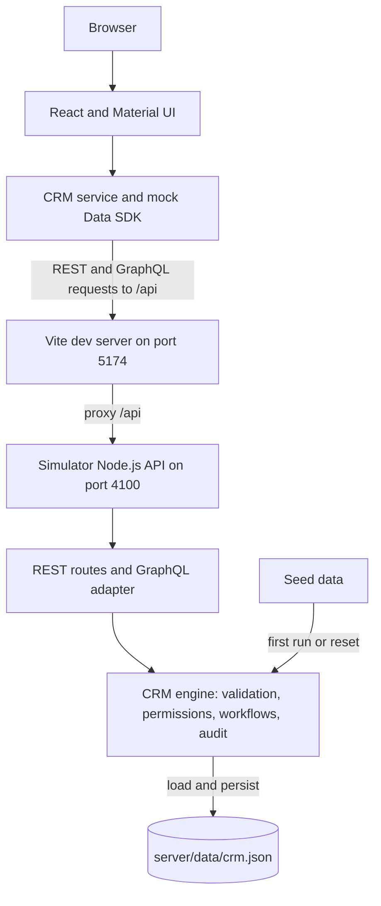

# Northstar CRM - sfReact_project

A local Salesforce-style CRM demonstration built with React and the SFCRMSIMULATOR API. It provides role-based CRM screens and CRUD operations without connecting to Salesforce or using real Salesforce credentials.

The application demonstrates:

- Role-based login for Admin, Sales Manager, Sales Representative, and Support Agent users
- Dashboard metrics and CRM activity
- Leads, accounts, contacts, opportunities, cases, and tasks
- Lead conversion into account, contact, and opportunity records
- Account management with a related-record Customer 360 view
- Stage-gated opportunity workflow with manager approval and history
- Case escalation, resolution tasks, SLA notifications, and timelines
- Field validation, record ownership, and role permissions
- Audit history and role-access visibility
- A mock Salesforce Data SDK that sends GraphQL documents to the local API

## Technology stack

| Area | Technology |
|---|---|
| Frontend | React 19, JavaScript ES modules, Material UI, Vite |
| Connected backend | Node.js HTTP server in `SFCRMSIMULATOR` |
| API | REST endpoints and a limited UI-API-style GraphQL adapter |
| Connected app storage | Local JSON file managed by the simulator |
| Optional backend | NestJS and MySQL scaffold in `sfReact-project/server` |
| Package management | npm workspaces for the React project; separate npm package for the simulator |
| Development runner | `concurrently` starts the simulator API and React UI |

## Application architecture



## Request flow

1. The React app checks `GET /api/health` before showing the workspace.
2. The UI calls `client/src/sdk/crmService.js` and the mock Data SDK in `client/src/sdk/sfDataMockSdk.js`.
3. Vite forwards requests under `/api` to the simulator API; the browser does not connect directly to the data file.
4. The simulator routes GraphQL CRUD requests through its limited GraphQL adapter and workflow operations through REST endpoints.
5. The CRM engine validates fields and demo-role permissions, runs relevant automation, and reads or writes the JSON store.
6. The API returns JSON; the React app updates the list, dashboard, or Customer 360 view.

The simulator API is the shared data service for both frontends. The simulator's own UI is optional and runs on port 5173; the connected React UI runs on port 5174 by default.

## Folder structure

```text
saleforce/
|-- sfReact-project/                 Connected React application and npm workspace
|   |-- client/
|   |   |-- src/App.jsx              UI routing and application state
|   |   |-- src/components/           Layout, CRM resources, and dialogs
|   |   |-- src/pages/                Dashboard, insights, Customer 360
|   |   |-- src/sdk/                  CRM services and mock Data SDK
|   |   `-- vite.config.js            API proxy, port, and SDK alias
|   |-- docs/CRM_MODULE_DESIGN.md     CRM requirements and workflow design
|   |-- server/                       Optional NestJS/MySQL backend
|   |   |-- database/                 MySQL schema and relationships
|   |   `-- src/                      Controllers, services, validation
|   |-- package.json                  Workspaces and combined dev command
|   `-- README.md
|-- SFCRMSIMULATOR/                   Shared API, data engine, and optional second UI
|   |-- server/server.mjs             Node HTTP API entry point
|   |-- server/engine.mjs              CRM rules, workflows, persistence
|   |-- server/model.mjs               Objects, fields, roles, permissions
|   |-- server/seed.mjs                Initial sample CRM data
|   |-- server/graphql-lab.mjs         Supported GraphQL subset
|   |-- server/data/crm.json           Created at runtime; local persistent data
|   |-- src/                           Optional simulator React UI
|   `-- tests/                         API and workflow tests
`-- .gitignore                         Shared repository ignore rules
```

## Shared simulator data

The default connected app reads and writes `SFCRMSIMULATOR/server/data/crm.json`. It is a local JSON database, not MySQL or PostgreSQL:

1. On first API access, the engine creates the data directory, loads the seed records, applies data-shape defaults, and writes the JSON file.
2. On later starts, the engine reads the existing file so records persist between runs.
3. Creates, edits, conversions, workflow events, and other supported operations save the updated data. Writes go through a temporary file before replacing the main file.
4. The simulator API reads and writes this one store for both frontends.

There is no database service to start for the default app. Back up `SFCRMSIMULATOR/server/data/crm.json` while the API is stopped if you need to preserve local records. To discard local changes and restore the sample data, call the administrator-only reset endpoint:

```powershell
Invoke-RestMethod -Uri http://127.0.0.1:4100/api/reset -Method Post `
  -Headers @{ "x-demo-user" = "u1" } `
  -ContentType "application/json" -Body "{}"
```

This replaces the current local dataset.

To store the simulator database at a different location, set `CRM_DB_PATH` in the same PowerShell terminal before starting the app:

```powershell
$env:CRM_DB_PATH = "C:\crm-data\crm.json"
npm run dev
```

Use an absolute path so the file location does not depend on the directory used to launch Node.js.

The NestJS/MySQL backend under `sfReact-project/server` is a separate development scaffold; it is **not** used by `npm run dev` and is not a drop-in replacement for all simulator workflows. Its connection settings are read from `sfReact-project/.env`, based on `.env.example`.

See [CRM_MODULE_DESIGN.md](./docs/CRM_MODULE_DESIGN.md) for functional requirements, user stories, entity model/ERD, API contracts, workflows, validations, acceptance criteria, test cases, and production migration notes.

## Step-by-step setup

### 1. Install prerequisites

Install:

- Node.js 22 or newer
- npm

Verify Node.js and npm:

```powershell
node --version
npm --version
```

### 2. Install dependencies

Open PowerShell in `sfReact-project` (the folder containing its `package.json`):

```powershell
Set-Location C:\path\to\saleforce\sfReact-project
npm install
```

This installs the React client and the optional NestJS server workspace dependencies. Keep `sfReact-project` beside `SFCRMSIMULATOR`; the connected development command starts the simulator API from that sibling folder.

### 3. Start the connected application

From the same `sfReact-project` PowerShell terminal:

```powershell
npm run dev
```

This starts:

- SFCRMSIMULATOR API on `http://127.0.0.1:4100`
- Vite frontend on `http://127.0.0.1:5174`

Open `http://127.0.0.1:5174` in a browser. The React app and simulator use the same local dataset, so changes made in either interface are visible through the simulator API.

The startup screen waits for the simulator API health check. If the login screen does not appear, check that the API is available:

```powershell
Invoke-RestMethod http://127.0.0.1:4100/api/health
```

Stop both processes with `Ctrl+C` in the terminal running `npm run dev`.

If the default ports are already in use, choose alternate ports in PowerShell before starting:

```powershell
$env:PORT = "4110"
$env:CRM_API_TARGET = "http://127.0.0.1:4110"
$env:CLIENT_PORT = "5175"
npm run dev
```

### 4. Optional: run the simulator's second UI

The simulator API is already started by the connected app. To also run the simulator's separate UI, open another terminal:

```powershell
Set-Location C:\path\to\saleforce\SFCRMSIMULATOR
npm install
npm run dev
```

Open `http://127.0.0.1:5173`. Both UIs use the same API and data file. This second `npm install` is only needed for the simulator UI.

## Running separate processes

Run the simulator API by itself (from the simulator folder):

```powershell
Set-Location C:\path\to\saleforce\SFCRMSIMULATOR
npm start
```

Then, in a second terminal, start the connected React frontend:

```powershell
Set-Location C:\path\to\saleforce\sfReact-project
npm run dev -w client
```

Build the frontend:

```powershell
npm run build -w client
```

Run tests:

```powershell
npm test -w client
npm test --prefix ..\SFCRMSIMULATOR
```

## Optional MySQL backend

The default connected app uses the JSON database above. To develop against the separate MySQL backend instead:

1. Install and start MySQL, then create/configure a MySQL user.
2. From `sfReact-project`, create `.env` from the example and set `DB_HOST`, `DB_PORT`, `DB_USER`, `DB_PASSWORD`, and `DB_NAME`:

   ```powershell
   Copy-Item .env.example .env
   notepad .env
   ```

3. From `sfReact-project`, run the SQL setup scripts. `schema.sql` creates and seeds the database; `relations.sql` adds the foreign keys:

   ```powershell
   Get-Content -Raw .\server\database\schema.sql | mysql -u root -p
   Get-Content -Raw .\server\database\relations.sql | mysql -u root -p
   ```

   Review the scripts before rerunning them against data you need to keep; the schema script includes reset/setup operations.

4. Start the optional NestJS API:

   ```powershell
   Set-Location C:\path\to\saleforce\sfReact-project
   npm run start:dev -w server
   ```

   It listens on `http://127.0.0.1:4102`. This API is separate from the simulator on port 4100 and is not started by the default `npm run dev` command.

## How authorization works

This project uses a demo role-switching mechanism, not production authentication.

- The active demo user ID is sent with API requests.
- The server loads that user's role from `model.js`.
- `rolePermissions` controls CRUD operations for every CRM resource.
- Admin and manager users have broader record access.
- Sales users are restricted by ownership for some resources.
- Support users are restricted to assigned cases and owned tasks.
- Sales and support users cannot see account annual revenue.

Do not use `x-demo-user` or demo role switching as a security boundary in a deployed application.

## Simulator troubleshooting

Check the simulator API health endpoint:

```powershell
Invoke-RestMethod http://127.0.0.1:4100/api/health
```

If the response is not successful:

1. Confirm Node.js is running the simulator backend from its project folder.
2. Confirm port 4100 is available.
3. Restart `npm run dev` from the sfReact-project root.
