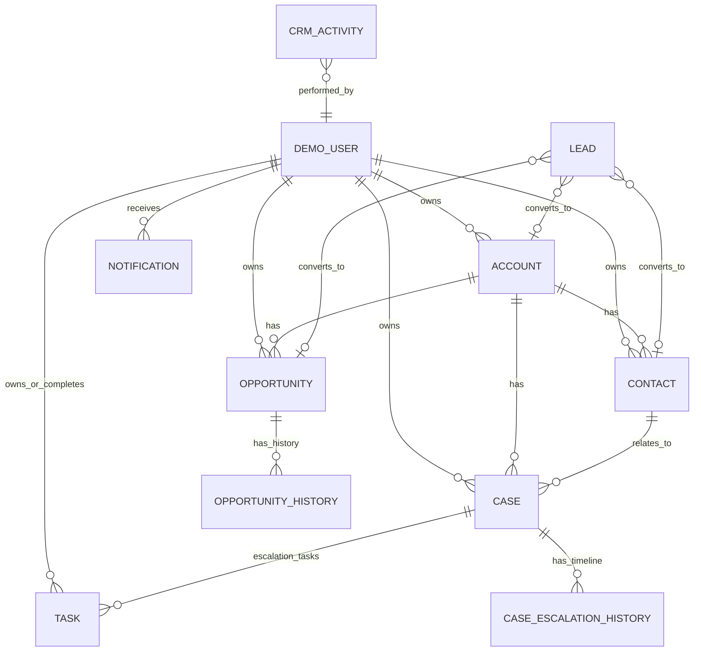
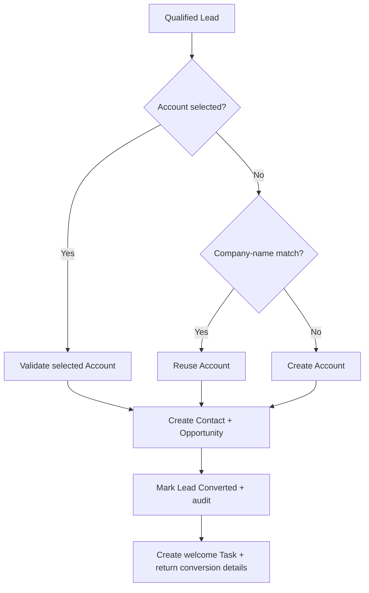
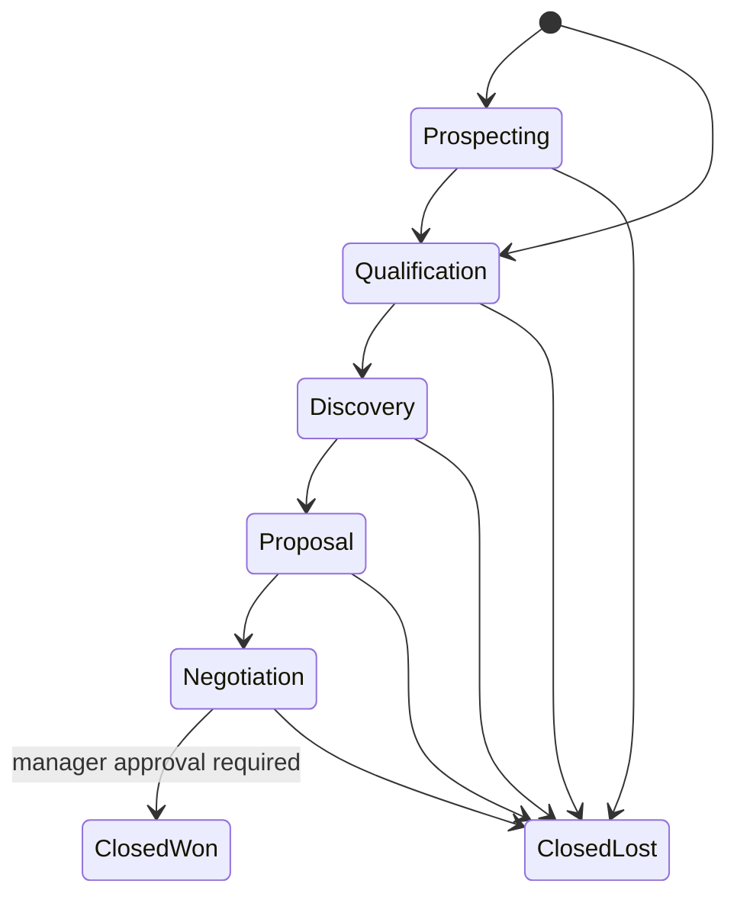
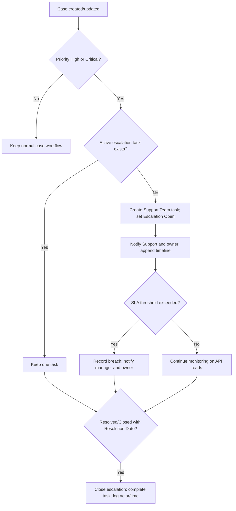

# CRM Modules: Requirements and Implementation

## Implementation profile

This design is implemented in the connected classroom application: React JavaScript with Material UI, a local Node.js CRM API, JSON persistence, and server-enforced classroom role permissions. The simulator does not currently use Express, SQL Server/PostgreSQL, or JWT authentication. `x-demo-user` remains a training-only identity selector and must not be treated as production authentication.

Policy defaults confirmed for this implementation:

- Every opportunity requires Sales Manager or Administrator approval before it can enter Closed Won.
- Critical case SLA: 4 hours. High case SLA: 24 hours.
- Notifications are in-app records and audit/timeline events; no email or SMS service is configured.
- The Support Team is represented by the Support Agent demo identity (`u4`).

## Functional requirements

### Lead conversion

- Only a Qualified Lead can be converted.
- Conversion accepts an optional existing Account ID. Without one, the service reuses an Account whose name matches the Lead company case-insensitively, or creates one.
- Conversion always creates one Contact and one Qualification-stage Opportunity under that Account.
- Conversion stores the linked Account, Contact, Opportunity, and conversion timestamp on the Lead.
- A second conversion attempt is rejected. The UI only offers Convert for Qualified, unconverted Leads and displays the generated record IDs and whether the Account was reused.
- The conversion and created records are written to the activity/audit history.

### Account management and Customer 360

- Account CRUD supports account name/number, industry, phone, email, website, billing and shipping address, status, owner, annual revenue (subject to field-level access), and system-managed created/modified timestamps.
- Account numbers are generated when omitted and must be unique when supplied.
- Account deletion is rejected while linked Contacts, Opportunities, Cases, or direct Tasks exist.
- Customer 360 is opened from an Account row. It presents account summary, computed health, contact/opportunity/case/task relationships, activity timeline, escalation timeline, open pipeline, weighted forecast, overdue tasks, and case escalation counts.
- Related-record tabs support text search, status filters where applicable, pagination, manual refresh, and 15-second polling.
- Health is `At Risk` for any open Critical Case or overdue Task, `Needs Attention` for another open High Case, and otherwise `Healthy`.

### Opportunity workflow

- New Opportunities begin at Prospecting or Qualification.
- Active stage order is Prospecting → Qualification → Discovery → Proposal → Negotiation → Closed Won. Closed Lost may be selected from any active stage. Closed opportunities cannot be reopened.
- Probability is system-managed from stage: Prospecting 10%, Qualification 20%, Discovery 35%, Proposal 55%, Negotiation 75%, Closed Won 100%, Closed Lost 0%.
- Moving to Closed Won is blocked until a manager approval is recorded. Any active opportunity may request approval; only a Sales Manager or Administrator may approve/reject a pending request.
- Stage transitions, approval requests/decisions, and probability changes are recorded in Opportunity history and audit activity.
- Forecast and weighted forecast are recalculated from current records. Stage changes notify the owner; approval requests notify managers.
- Opportunity creation creates a follow-up Task. Closing Won creates an onboarding Task.

### Case escalation and task automation

- Creating or updating a High/Critical Case creates at most one active escalation Task assigned to the Support Team and sets Escalation Status to Open.
- Resolving/closing a Case requires a Resolution Date. Resolution closes the escalation and completes its active escalation Task, capturing completion user/time.
- Resolved Cases cannot be reopened. Completed escalation Tasks cannot be reopened or deleted.
- Case assignment, status, resolution, escalation creation/closure, task completion, and SLA breach are recorded in Case Escalation History and the audit/activity feed.
- The service checks SLA deadlines when Customer 360 or the notifications endpoint is read. It creates a single breach event/notification per unresolved high-priority Case.
- Support receives escalation notifications, Case owners receive Case updates, and managers receive SLA breach notifications.

## User stories

1. As a Sales Representative, I can convert a Qualified Lead and choose an existing Account so that I avoid duplicate companies and get linked Contact/Opportunity records.
2. As a Sales Representative, I can see the conversion result and the Lead's Converted status so that I can trace the resulting records.
3. As an Account Manager, I can create, edit, search, view, and delete an Account when no dependent records prevent deletion.
4. As a customer-facing user, I can open Customer 360 from an Account and search/filter/page through its related records.
5. As a Sales Representative, I can advance an Opportunity one stage at a time and see the probability/forecast update.
6. As a Sales Representative, I can request Closed Won approval and see the pending/approved/rejected state.
7. As a Sales Manager, I can approve or reject pending opportunities and receive an in-app notification of requests.
8. As a Support Agent, I can see the Case escalation Task assigned to the Support Team and resolve the Case with a resolution date.
9. As a Case owner, I can see status/assignment updates and the escalation timeline.
10. As a Sales Manager, I can see SLA breach notifications and the affected Case history.

## Use cases

### Convert Lead

1. User opens Leads and selects Convert for a Qualified Lead.
2. UI loads accessible Accounts and lets the user choose one or select automatic company matching.
3. API validates ownership/permissions and checks the Lead is still Qualified and unconverted.
4. API reuses or creates an Account, creates a Contact and Opportunity, stamps conversion fields, creates a welcome Task, and writes audit/activity events.
5. UI refreshes Leads and displays the Account/Contact/Opportunity IDs and conversion timestamp.

### Close an Opportunity Won

1. Owner requests approval from the Opportunity list.
2. API marks approval Pending, writes history, and notifies Sales Managers.
3. Manager approves or rejects from the Opportunity list; API records the decision and notifies the owner.
4. Once Approved, an authorized owner advances Negotiation to Closed Won.
5. API sets probability to 100%, updates forecast, writes stage history, and creates the onboarding Task.

### Resolve an escalated Case

1. A High/Critical Case is created or raised in priority.
2. API creates one Support Team escalation Task, opens escalation status, logs the event, and notifies Support and the owner.
3. The owner resolves/closes the Case with a Resolution Date.
4. API closes escalation, completes its Task, records user/time and timeline entries, and sends notifications.

## Logical entities and ERD

### Entity fields

- **Account**: `Id`, unique `AccountNumber`, `Name`, `Industry`, `Phone`, `Email`, `Website`, billing/shipping address parts, `Status`, `AnnualRevenue`, `OwnerId`, `CreatedDate`, `LastModifiedDate`.
- **Lead**: standard lead fields, `Status`, `ConvertedAccountId`, `ConvertedContactId`, `ConvertedOpportunityId`, `ConversionDate`, `OwnerId`.
- **Contact**: name/contact fields, `AccountId`, `OwnerId`.
- **Opportunity**: `Name`, `AccountId`, `StageName`, system-managed `Probability`, `ApprovalStatus`, `ApprovedById`, `ApprovedAt`, `CloseDate`, `Amount`, `OwnerId`.
- **Case**: subject/description, `AccountId`, `ContactId`, `Status`, `Priority`, `ResolutionDate`, system-managed escalation and SLA timestamps, `OwnerId`.
- **Task**: `Subject`, `Status`, `Priority`, `ActivityDate`, polymorphic `RelatedToId`, optional system-managed `EscalationForCaseId`, `CompletedAt`, `CompletedById`, `OwnerId`.
- **OpportunityHistory**: Opportunity, from/to stage, probability/approval state, actor, timestamp.
- **CaseEscalationHistory**: Case, action/details, actor, timestamp.
- **CRMActivity/Audit**: resource, record, operation, label/details, actor, timestamp.
- **Notification**: recipient, type, message, record ID, created/read timestamps.
- **DemoUser**: simulator identity, display name, role. This is not a secure user/authentication table.

The current JSON store contains arrays for these entities. `Task.RelatedToId` remains polymorphic to support links to Accounts, Contacts, Opportunities, and Cases. The API enforces the active escalation-task uniqueness rule in application logic; a future SQL migration should add a filtered unique index.

## REST API

All endpoints are under `/api`; the selected classroom identity is supplied via `x-demo-user`. Existing generic CRUD and the teaching GraphQL endpoint remain available.

| Method and path | Purpose |
|---|---|
| `GET /accounts?q=` | Search/list accessible Accounts |
| `POST /accounts` | Create Account; AccountNumber is generated if absent |
| `GET /accounts/:id` | Read Account |
| `PATCH /accounts/:id` | Update Account |
| `DELETE /accounts/:id` | Delete only when no dependent records exist |
| `GET /accounts/:id/360?tab=&page=&pageSize=&q=&status=` | Customer 360 summary and paginated related rows |
| `POST /leads/:id/convert` | Convert Qualified Lead; optional body `{ "accountId": "001..." }` |
| `POST /opportunities/:id/approval` | Request/decide approval with `{ "decision": "request\|approve\|reject" }` |
| `GET /opportunities/:id/history` | Read stage and approval history |
| `GET /cases/:id/escalation-history` | Read escalation timeline |
| `GET /notifications` | List notifications for the current identity; evaluates SLA breaches |
| `PATCH /notifications/:id` | Mark the current user's notification as read |

Customer 360 returns `{ account, healthStatus, summary, relatedCounts, tab, rows, total, page, pageSize, pageCount, recentActivities, escalationTimeline }`. Unsupported tabs are normalized to `contacts`; page size is clamped to 1–50. Invalid operations return an explicit error/status rather than a success-shaped response.

## UI mockup description

- **Accounts list**: searchable Account table with Create/Edit/Delete, Account Number, Status and a Customer 360 action.
- **Account form**: identity, contact, billing/shipping, status, owner, and revenue fields; protected revenue remains hidden for restricted roles.
- **Customer 360 header**: Account identity, Account Number, Status, Health chip, and modified timestamp.
- **Customer 360 KPIs**: open Opportunities, open pipeline, weighted forecast, open Cases, pending/overdue Tasks, escalation count.
- **Customer 360 sections**: Account information and addresses; tabs for Contacts, Opportunities, Cases, Tasks, and Timeline; text search, relevant status filter, pagination, refresh/polling; case escalation timeline.
- **Opportunity list**: stage/probability/approval columns, approval request and manager decision actions, plus a history dialog.
- **Lead list**: Convert opens an Account selector/automatic-match confirmation; completion view shows linked record IDs and whether the Account was reused.
- **Case list/form**: Case status, priority, resolution date, escalation status; closing status makes Resolution Date mandatory.
- **Global notification menu**: unread count, message/time, mark-read behavior, and navigation to relevant CRM list.

## Workflow diagrams

### Lead conversion

### Opportunity

### Case escalation and resolution

## Validation rules

1. Account Name is required; AccountNumber is unique; Email must be valid; Status must be Active or Inactive; monetary values are non-negative.
2. Lead conversion requires Qualified status, valid user access, and an unconverted Lead. Conversion fields are system-managed.
3. Contact/Opportunity/Case foreign keys must reference existing records.
4. Opportunity creation starts at Prospecting or Qualification. Active stage movement is one step forward; Closed Lost is permitted from any active stage; terminal stages cannot be reopened.
5. Probability is calculated by stage and cannot be written directly.
6. Closed Won requires Approved status. Only a Manager/Administrator may decide a pending request.
7. Case ResolutionDate is required before Resolved/Closed. Resolved Cases cannot be reopened.
8. Only one active escalation Task is allowed for each Case. Escalation Tasks cannot be deleted or reopened after completion.
9. Owner assignment is limited to Administrator/Manager; record sharing and object CRUD are checked server-side.
10. Sales and Support users cannot read/write Account AnnualRevenue.
11. Notifications can be marked read only by their recipient (or Administrator).

## Acceptance criteria

- A matching Account is reused case-insensitively; a selected Account is honored; Contact and Opportunity reference that Account.
- Conversion details are returned and displayed; repeated conversion returns an error and does not create duplicates.
- Account fields persist and render; duplicate AccountNumber/email formats are rejected; linked Account deletion is blocked.
- Customer 360 exposes all permitted related records and metrics; query search/status filtering/pagination work; polling refreshes data.
- Opportunity probability follows stage, skipped/backward moves fail, every Closed Won requires approval, decisions are role-checked, and stage/approval history is visible.
- Case escalation creates one Support-owned task, notifies Support, records timeline events, and closes/completes the task with user/time when resolved.
- Resolution without a date fails. Closed escalation Tasks cannot be reopened. Manager receives a single notification per SLA breach.
- CRUD, conversion, stage, approval, escalation, resolution, task completion, and SLA activity is auditable.

## Test cases

Automated server tests cover:

1. Qualified Lead conversion, Account matching/reuse, related IDs, conversion timestamp, and duplicate prevention.
2. Invalid Account email and duplicate AccountNumber rejection.
3. Account Customer 360 related counts and server-side pagination.
4. Opportunity approval request/role denial/manager approval, Closed Won gate, stage history, probability update, and onboarding Task.
5. Critical escalation task ownership and deduplication.
6. Required Case Resolution Date, task completion actor/time, escalation closure, history entries, and no task reopening.
7. Critical 4-hour and High 24-hour SLA breach notification behavior.
8. Existing CRUD permissions, field-level security, GraphQL reads/mutations, lead conversion validation, and relationship delete restrictions.

## Production migration notes

The current app is a local classroom simulator, not a production CRM. For a production deployment, replace the JSON store with SQL Server/PostgreSQL transactions and foreign keys, add authenticated JWT/OIDC identity, enforce RBAC server-side, persist an immutable audit log, use a scheduler/queue for SLA evaluation, and integrate a real notification provider. These items are intentionally outside the current connected-app target.
